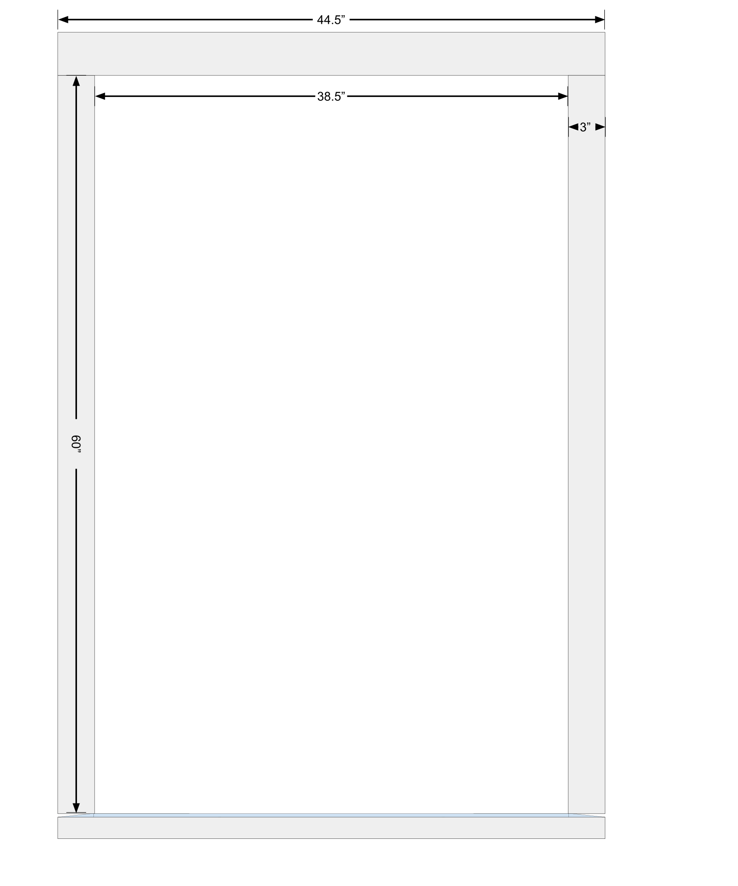

# street-cleaning-revealed

Year-round outdoor LED art installation that frames a window of roughly **105 cm × 160 cm**. The top and bottom strips are a fixed color then eventually an animated pattern. The **two side strips act as bar graphs** whose displayed value ranges over **0–21** and is **updated once a day**, with colors that can be changed and values calculated from calendar dates. Control is by an **ESP32 microcontroller running FastLED**. In a later phase the controller will use **WiFi and HTTPS** to monitor a web page for keywords and augment the 0–21 values with information gleaned from there.

